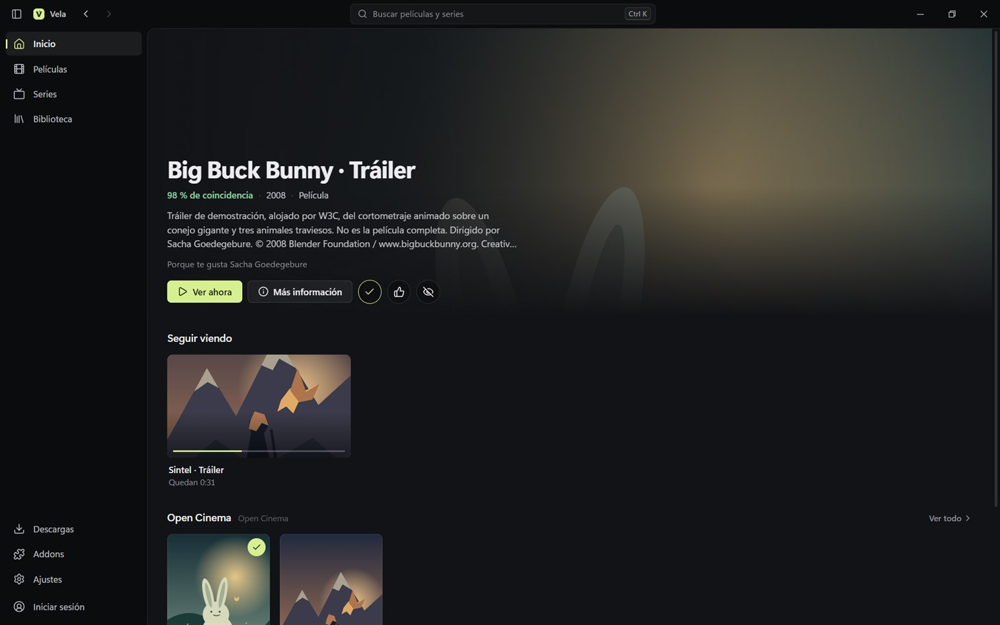
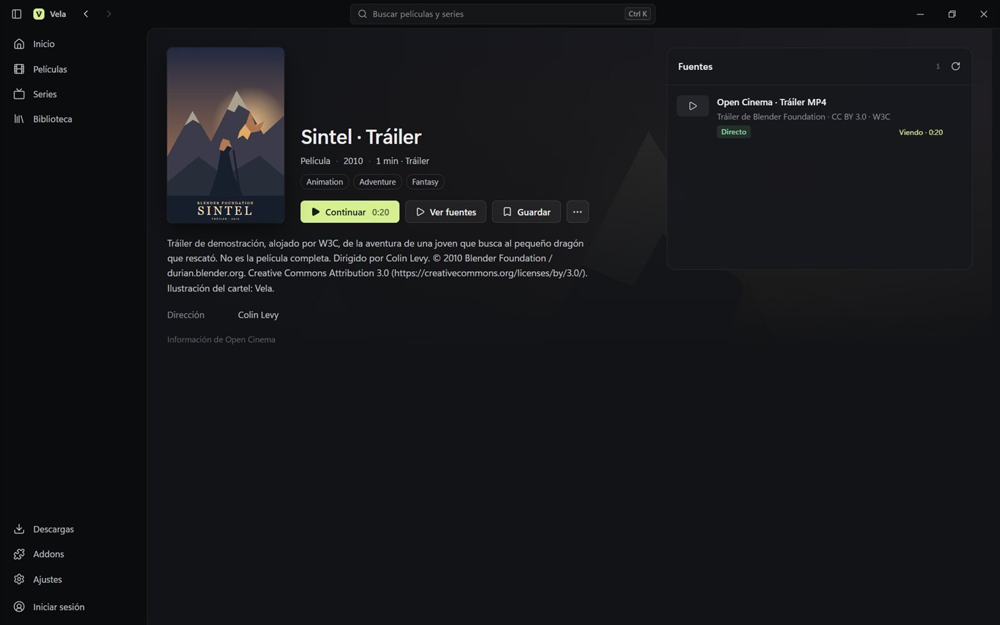
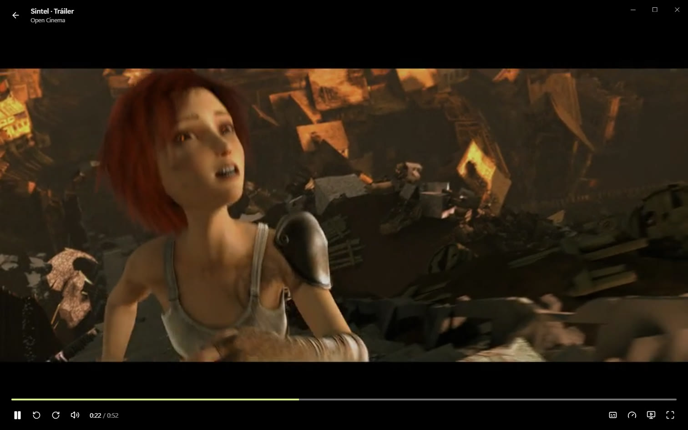
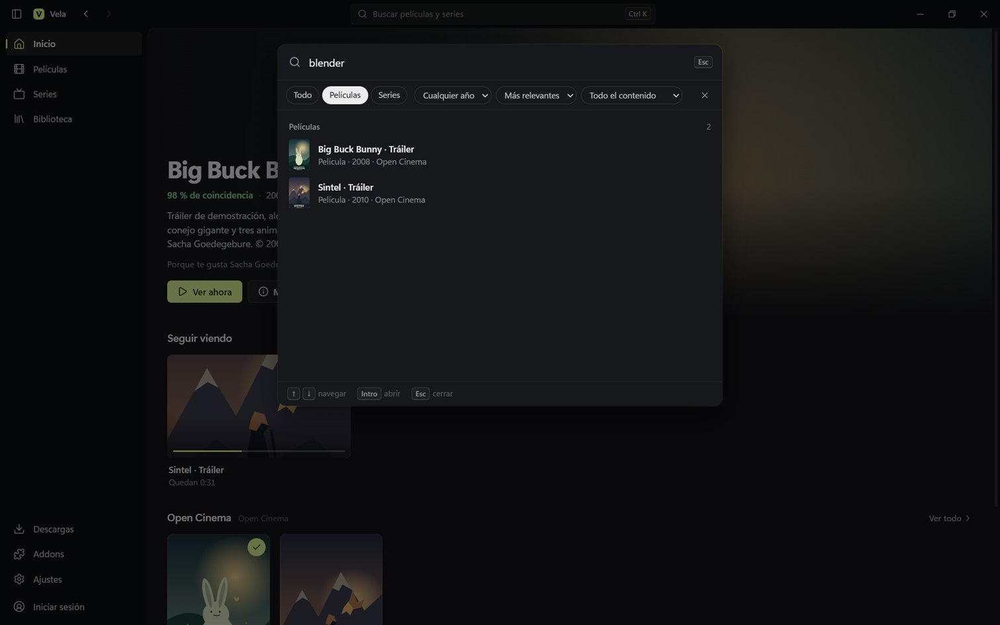
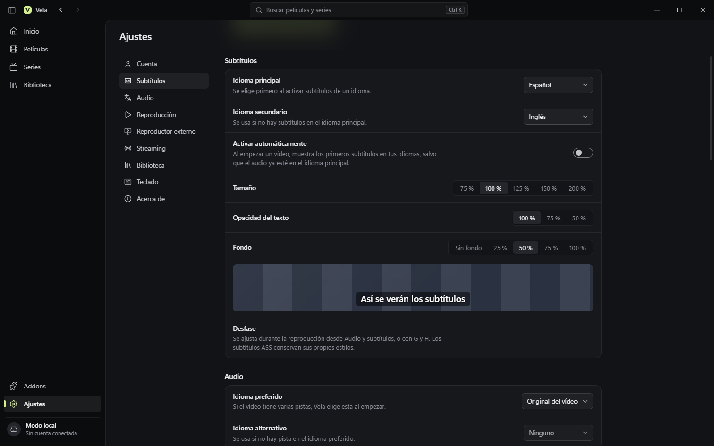

<p align="center">
  
</p>

<h1 align="center">Vela</h1>

<p align="center">
  Cliente de escritorio para Windows compatible con los addons de Stremio.<br>
  Hecho con Tauri 2, Rust, React y TypeScript. No es una aplicación oficial de Stremio.
</p>

<p align="center">
  <a href="https://github.com/roberthgnz/Vela/releases/latest"></a>
  <a href="https://github.com/roberthgnz/Vela/actions/workflows/ci.yml"></a>
  <a href="LICENSE"></a>
  
</p>

<p align="center">
  <a href="https://github.com/roberthgnz/Vela/releases/latest"><b>Descargar para Windows</b></a>
  ·
  <a href="#funciones">Funciones</a>
  ·
  <a href="#desarrollo">Desarrollo</a>
  ·
  <a href="CONTRIBUTING.md">Contribuir</a>
</p>

<p align="center">
  
</p>

## Interfaz

<table>
  <tr>
    <td width="50%"></td>
    <td width="50%"></td>
  </tr>
  <tr>
    <td align="center">Detalle con episodios y fuentes</td>
    <td align="center">Reproductor integrado</td>
  </tr>
  <tr>
    <td width="50%"></td>
    <td width="50%"></td>
  </tr>
  <tr>
    <td align="center">Búsqueda con filtros e historial (<kbd>Ctrl</kbd> <kbd>K</kbd>)</td>
    <td align="center">Ajustes agrupados por tareas</td>
  </tr>
</table>

Ventana sin marco con barra de título propia, barra lateral plegable e historial atrás/adelante: al volver atrás se recuperan filtros, temporada, scroll y foco. Todo se maneja con el teclado, también el reproductor con los atajos de YouTube; <kbd>F1</kbd> muestra la lista.

Las capturas usan los tráileres de Blender Foundation incluidos en Vela (CC BY 3.0).

## Funciones

- Catálogos y búsqueda de Cinemeta y de los addons instalados; detalles, temporadas y episodios.
- Información en el idioma elegido (español por defecto): Cinemeta solo ofrece inglés, así que con una clave gratuita de TMDB Vela traduce títulos, sinopsis, géneros y episodios del detalle y del reproductor.
- Instalación, activación, desactivación y eliminación de addons por URL de manifiesto.
- Fuentes y subtítulos de los addons instalados; los manifiestos instalados se actualizan al abrir Vela.
- Subtítulos externos, de torrents e incrustados en el archivo (a través de Stremio Service): SRT, WebVTT y ASS/SSA, con detección de codificación (UTF‑8, UTF‑16, Windows‑1252) y de formato, duplicados eliminados y errores claros con archivos dañados. ASS/SSA con estilos mediante JASSUB (libass en WebAssembly). Idioma principal y secundario, selección automática, desfase, tamaño, opacidad y fondo.
- Pistas de audio múltiples en MP4, MKV y HLS, con idioma preferido y alternativo.
- Perfiles locales («¿Quién está viendo?» al abrir Vela): cada uno con su biblioteca, progreso, vistos, historial de fuentes y preferencias; addons y servicios compartidos. La cuenta de Stremio se sincroniza con el perfil desde el que se inició sesión.
- Biblioteca e historial locales por episodio, marcas de vistos, reanudación por episodio, siguiente episodio con la fuente del mismo `bingeGroup` y cuenta atrás configurable. Exportación a JSON y vaciado con confirmación. Todo se guarda en una base de datos SQLite propia (`%APPDATA%\com.vela.desktop\vela.db`) con una copia diaria en `backups/` (se conservan siete) y «Crear copia ahora» en Ajustes; la primera vez se copian los datos que las versiones anteriores guardaban en WebView2, sin borrarlos.
- Reproductor integrado para MP4/WebM/MKV y HLS. Si Stremio Service está disponible, los archivos incompatibles (por ejemplo HEVC) se sondean y se convierten a HLS; cualquier error de decodificación o una carga demasiado lenta ofrece la conversión o un reproductor externo.
- Torrents mediante el servidor de streaming de Stremio: creación del torrent, selección del archivo por el servicio (con temporada y episodio en series), trackers de `sources`, validación de que el archivo elegido es un vídeo y mensajes para servicio caído o torrent sin pares.
- Fuentes con cabeceras HTTP obligatorias: a través del proxy de Stremio Service cuando el destino es HTTPS, o con MPV, al que Vela pasa las cabeceras.
- MPV seguido por IPC: reanuda en la posición guardada, informa del progreso, detecta el cierre y el final, marca vistos y avanza al siguiente episodio.
- Cuenta de Stremio: vinculación desde el navegador (sin introducir la contraseña en Vela) o correo y contraseña. La clave de sesión se guarda en el Administrador de credenciales de Windows. Sincronización en ambos sentidos de biblioteca, elementos temporales de «Seguir viendo», progreso, siguiente episodio y vistos por episodio (el campo `watched` de Stremio), conservando los campos remotos que Vela no edita; lectura e instalación de los addons de la cuenta. Vela no envía actividad de reproducción a los addons.
- Dos tráileres de demostración para probar la reproducción sin un proveedor de películas.

## Límites actuales

Cinemeta proporciona metadatos, no películas reproducibles. Las fuentes dependen de los addons que instale el usuario. Stremio Service y MPV no se incluyen: Vela usa el servidor que instala Stremio o Stremio Service. No hay motor torrent propio ni libmpv integrado; la conversión de formatos depende de ese servidor.

La sincronización de la cuenta sigue los contratos de stremio-core y se ha comprobado contra la API real en los casos que no necesitan credenciales (vinculación, errores y sesión caducada), pero no con una cuenta real: el primer uso debería hacerse exportando antes la biblioteca. Vela no modifica la colección de addons de la cuenta. El ejecutable de MPV no estaba instalado en el equipo de desarrollo; el seguimiento por IPC se comprobó con la libmpv que incluye Stremio y con pruebas sobre una tubería con nombre.

El servidor de Stremio solo envía cabeceras CORS a orígenes de Stremio, así que Vela reproduce sus listas HLS con el reproductor nativo de WebView2 y lee sus subtítulos a través de Rust. Las pistas de audio dependen de la función `AudioVideoTracks` de WebView2, que Vela activa en la ventana. Los subtítulos ASS usan la fuente por defecto de JASSUB; no se cargan las fuentes adjuntas al MKV.

El proxy de cabeceras del servidor de Stremio solo acepta destinos HTTPS. Los enlaces directos y las listas HLS dependen de sus códecs, CORS y disponibilidad. Abrir un instalador generado localmente sin firma puede mostrar el aviso habitual de Windows.

## Desarrollo

Requiere Node 22.12 o posterior, pnpm 11, Rust estable, las herramientas de compilación C++ de Microsoft y WebView2.

```powershell
pnpm install --frozen-lockfile
pnpm desktop
```

`pnpm desktop` abre la ventana Tauri con recarga automática. `pnpm dev` sirve solo la interfaz en `http://127.0.0.1:1430` para desarrollo; no es necesario para utilizar la aplicación empaquetada.

```powershell
pnpm build
pnpm test
cargo test --manifest-path src-tauri/Cargo.toml
pnpm package
```

El instalador se genera en `src-tauri/target/release/bundle/nsis/`. `pnpm package` firma además el instalador para la actualización automática, así que necesita la clave privada de actualizaciones: `$env:TAURI_SIGNING_PRIVATE_KEY = "<ruta o contenido de la clave>"` y `$env:TAURI_SIGNING_PRIVATE_KEY_PASSWORD = ""`. Sin ella, compila con `pnpm tauri build --bundles nsis --config '{"bundle":{"createUpdaterArtifacts":false}}'` (PowerShell 7.3 o posterior).

### Versiones en GitHub

- **CI** ([ci.yml](.github/workflows/ci.yml)): en cada push a `main` y en cada pull request comprueba tipos, compila la interfaz y ejecuta las pruebas unitarias (Ubuntu), y `cargo fmt`, `clippy` y las pruebas Rust (Windows).
- **Release** ([release.yml](.github/workflows/release.yml)): genera el instalador NSIS en Windows tras pasar las pruebas y lo publica en [Releases](https://github.com/roberthgnz/Vela/releases) con su suma SHA-256 y notas generadas a partir de los commits. Se lanza de dos formas:
  - subiendo una etiqueta igual a la versión: actualiza la versión en `package.json`, `src-tauri/Cargo.toml` y `src-tauri/tauri.conf.json`, haz commit y ejecuta `git tag v0.3.0` y `git push origin v0.3.0`;
  - o desde Actions › Release › Run workflow, que etiqueta el commit elegido como `v<versión>` (opcionalmente como borrador).

El flujo falla si las tres versiones no coinciden o si la etiqueta no corresponde a la versión. Si la versión ya está publicada, sustituye los archivos adjuntos.

### Actualización automática

Desde la 0.3.2, Vela consulta al arrancar `https://github.com/roberthgnz/Vela/releases/latest/download/latest.json` (se puede desactivar en Ajustes › Acerca de, donde también está «Buscar ahora»). Si hay una versión nueva lo avisa; al aceptar, descarga el instalador, comprueba su firma con la clave pública de `tauri.conf.json`, lo instala en modo pasivo y vuelve a abrir Vela. Nada se instala sin confirmación.

El workflow de release firma el instalador con el secreto `TAURI_SIGNING_PRIVATE_KEY` y publica el `.sig` y `latest.json` ([dev/updater-manifest.mjs](dev/updater-manifest.mjs)). La clave privada no está en el repositorio: si se pierde, las copias instaladas no aceptarán más actualizaciones y habrá que reinstalar a mano con una clave nueva. `VELA_UPDATE_ENDPOINT` cambia la dirección consultada para probar con un `latest.json` local; la firma se comprueba igual.

La firma de actualizaciones no es la firma de código de Windows: el instalador no está firmado con un certificado y Windows puede mostrar su aviso al ejecutarlo a mano. La aplicación empaquetada incluye su interfaz y no requiere Node ni el servidor Vite en el equipo del usuario. WebView2 es un requisito de ejecución.

`node dev/validation-addon.mjs` sirve en `http://127.0.0.1:7010/manifest.json` un addon local con fuentes de validación: torrents CC de Blender (con y sin `fileIdx`, con trackers, índice erróneo, hash sin pares), un MP4 que exige cabeceras, un MKV/HEVC, un MKV con dos pistas de audio y subtítulos SRT y ASS incrustados, subtítulos externos (Windows‑1252, ASS, duplicados y un archivo dañado) y una serie de tres episodios con `bingeGroup`. `node dev/make-validation-media.mjs` genera esos archivos sintéticos con FFmpeg en `.tmp/media/`.

## Contribuir

Las aportaciones son bienvenidas. Lee [CONTRIBUTING.md](CONTRIBUTING.md) antes de abrir un pull request y el [código de conducta](CODE_OF_CONDUCT.md). Los errores y propuestas van en [issues](https://github.com/roberthgnz/Vela/issues); los problemas de seguridad, por el informe privado descrito en [SECURITY.md](SECURITY.md).

## Aviso legal

Vela no proporciona, aloja ni indexa contenido. Reproduce lo que ofrecen los addons que instala cada usuario, que son responsabilidad de sus autores; usa solo fuentes a las que tengas derecho a acceder. Stremio es una marca de sus titulares; Vela no está afiliado ni respaldado por Stremio.

## Licencia

Vela se distribuye bajo la [licencia MIT](LICENSE). Las dependencias y los recursos de terceros conservan sus propias licencias (ver «Créditos»).

## Créditos

Big Buck Bunny y Sintel son obras de Blender Foundation. Vela incluye ilustraciones propias y enlaces a sus tráileres, alojados por W3C; no incluye las películas completas. Los tráileres se distribuyen bajo [Creative Commons Attribution 3.0](https://creativecommons.org/licenses/by/3.0/). Véanse [Big Buck Bunny](https://peach.blender.org/) y [Sintel](https://durian.blender.org/). El addon de validación usa los torrents de muestra de WebTorrent de esas mismas obras.

Las traducciones de títulos, sinopsis, géneros y episodios usan la [API de TMDB](https://www.themoviedb.org/) con la clave de cada usuario. Vela no está respaldada ni certificada por TMDB.

Los subtítulos ASS/SSA se dibujan con [JASSUB](https://github.com/ThaUnknown/jassub) 2.5.18 (código MIT; incluye libass y bibliotecas con licencias ISC, FTL/GPL-2.0, LGPL-2.1 y otras, declaradas en su paquete). Su worker y sus archivos WebAssembly se distribuyen como archivos separados.

Las banderas de idioma usan la fuente «Twemoji Country Flags» de [country-flag-emoji-polyfill](https://github.com/talkjs/country-flag-emoji-polyfill) (código MIT), incluida en `public/fonts/` porque Windows no dibuja emojis de banderas. Sus gráficos son de [Twemoji](https://github.com/twitter/twemoji), © Twitter, Inc. y otros colaboradores, bajo [CC BY 4.0](https://creativecommons.org/licenses/by/4.0/).

El cliente implementa el [protocolo de addons](https://github.com/Stremio/stremio-addon-sdk/blob/master/docs/protocol.md). No incorpora código de las interfaces oficiales de Stremio. Las dependencias conservan sus propias licencias.
